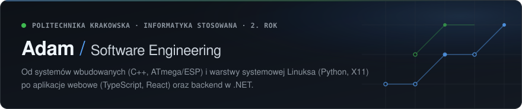

<picture>
  <source media="(prefers-color-scheme: dark)" srcset="assets/hero-dark.svg" />
  <source media="(prefers-color-scheme: light)" srcset="assets/hero-light.svg" />
  
</picture>

 

Jestem studentem 2. roku **Informatyki Stosowanej na Politechnice Krakowskiej**. Rozwijam się w szeroko rozumianej inżynierii oprogramowania — od niskopoziomowego kodu na mikrokontrolery i aplikacji systemowych pod Linuksem po aplikacje webowe i backend.

W projektach sprzętowo-programowych realizowanych wspólnie z kolegą (`vena3-plc`, `VenaV-speaker`) odpowiadałem **wyłącznie za warstwę informatyczną i oprogramowanie**.

---

## Wyróżnione projekty

### [`vena3-plc`](https://github.com/AdamAdamnomnom/vena3-plc)
`C++` `Arduino Core` `ATmega328 / ESP8266` `Embedded`

Obiektowa biblioteka w C++ przenosząca paradygmaty sterowników PLC (nieblokujące timery na `millis()`, liczniki, markery, bramki logiczne, pamięć nieulotna EEPROM, komunikacja szeregowa oraz przerwanie sprzętowe E-STOP) na mikrokontrolery.

- **Zakres udziału:** Projekt stworzony we współpracy z kolegą — odpowiadałem **wyłącznie za stronę informatyczną** (biblioteka `venaPilot3.h`, programy sterujące `Pilot3.ino`, dokumentacja API).

---

### [`VenaV-speaker`](https://github.com/AdamAdamnomnom/VenaV-speaker)
`Python` `PyQt6` `Debian 13 / X11` `CDP` `ALSA / LADSPA`

Autonomiczny system kioskowy audio/wideo dla terminala cienkiego Fujitsu Futro S930 (ekran dotykowy 1024×768). Łączy nakładkę `AlwaysOnTop` w PyQt6 z dwoma procesami Chromium sterowanymi przez Chrome DevTools Protocol, zarządzaniem oknami przez `python-xlib` (`stow` poza ekranem zamiast niestabilnego `unmap`), regulacją głośności ALSA, korektorem LADSPA DSP i dwustopniowym watchdogiem.

- **Zakres udziału:** Projekt stworzony we współpracy z kolegą — odpowiadałem **wyłącznie za warstwę informatyczną** (aplikacja w Pythonie, integracja z X11/CDP, konfiguracja Debiana/Openbox i toru audio).

---

### [`review-the-game`](https://github.com/AdamAdamnomnom/review-the-game)
`React 19` `TypeScript` `Tailwind CSS` `Vite`

Przeglądarkowa gra edukacyjna ucząca Code Review i analizy diffów Pull Requestów w trzech poziomach trudności (Junior, Mid, Senior). Mechanika wymusza dwuetapową analizę (wskazanie podejrzanej linii + diagnoza problemu) z ujemnymi punktami za zgadywanie.

- **Metodyka:** Eksperymentalny projekt zrealizowany w podejściu **vibecoding** (szybkie prototypowanie wspomagane narzędziami AI).

---

## Technologie i narzędzia

| Obszar | Wykorzystywane technologie |
|---|---|
| **Języki** | `C++` `Python` `C#` `TypeScript` |
| **Web i Backend** | `.NET` `React` `REST API` `EF Core` `Tailwind CSS` |
| **Systemy i Embedded** | `Linux (Debian)` `X11 / Openbox` `Arduino / ESP8266` `ALSA / PulseAudio` |
| **Warsztat** | `Git` `PyQt6` `xUnit` `Vite` `AI-assisted dev` |

---

## Kierunek rozwoju

Poza repozytoriami publicznymi rozwijam projekty backendowe w **C# / .NET** (Clean Architecture, Entity Framework Core, uwierzytelnianie JWT, testy xUnit) i poszerzam warsztat z szeroko rozumianej inżynierii oprogramowania.

---

GitHub: [github.com/AdamAdamnomnom](https://github.com/AdamAdamnomnom)
